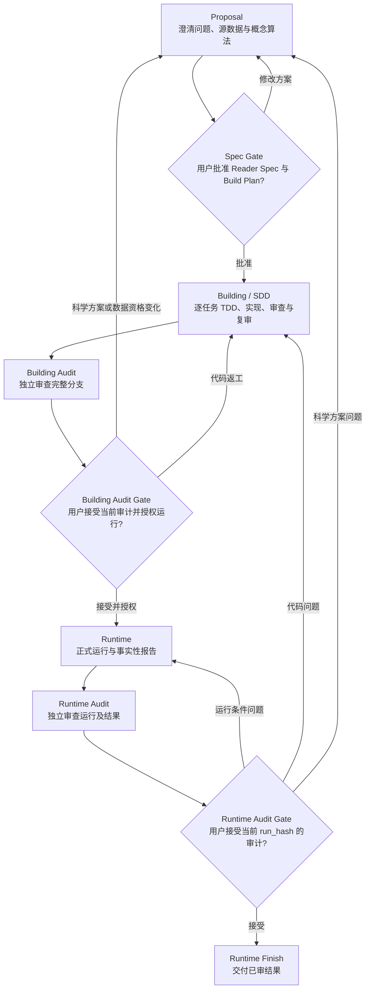

# Scientific Analysis Superpower

面向科研统计分析的 Agent Skill：以**一个最小功能单元**为范围，先确定科学方案与实施计划，再按 [Superpowers](https://github.com/obra/superpowers) 的 Subagent-Driven Development（SDD）方式逐任务开发、测试和审查，最后对正式运行及结果分别留痕和审计。

根目录的 [SKILL.md](SKILL.md) 是调度入口：它根据现有 Spec、Git 提交、审计报告和用户裁决判断当前阶段，按需读取对应模块。本 README 介绍流程；实际执行以 `SKILL.md`、`references/` 和 `templates/` 为准。

## 流程一览



| 阶段 | 主要工作 | 主要产物与停止点 |
|---|---|---|
| **Proposal** | 用 brainstorming 明确研究目标、合格源数据、概念算法和结论边界；用 writing-plans 拆出可测试的实施任务。 | `specs/reader_spec.md` 与 `specs/build_plan.md`。停在 **Spec Gate**，等待用户批准当前版本。 |
| **Building / SDD** | 在隔离的 Git 工作区按计划逐任务执行 TDD、实现、提交、独立 Task Review 和必要的修复复审。 | 代码、测试、提交及任务账本；完成后进行完整分支审查。 |
| **Building Audit** | 一名独立 Reviewer 追溯 Spec、Plan、代码、测试及任务审查，形成正式报告。 | `audits/building/` 下的报告绑定当前提交；停在 **Building Audit Gate**，等待用户裁决及运行授权。 |
| **Runtime** | 只对获准的代码、输入和配置执行正式运行，记录实际经过与产物身份。 | `results/`、日志及事实性的 Runtime Report，使用 `run_hash` 绑定版本。报告本身不是审计结论。 |
| **Runtime Audit** | 独立核对输入、代码、配置、运行和结果是否对应，检查完整性、科学口径及解释边界。 | `audits/runtime/` 下的报告绑定当前 `run_hash`；停在 **Runtime Audit Gate**。 |
| **Runtime Finish** | 整理已获接受的结果、复现信息、解释边界和限制。 | `reports/` 下的最终交付说明；不新增计算。 |

## SDD 怎样开发一个任务

Build Plan 决定任务边界。Building 不重新制定科学方案，而是按批准的计划执行：

1. 建立或核对隔离工作树，为本份计划创建 `.tmp/sdd/` 临时账本，并检查任务之间的依赖与接口冲突。
2. 从 Build Plan 提取 **Task N brief**，派独立实现 Agent。按 TDD 先用有独立依据的预期写失败测试，再做最小实现、重构、自查和 Git 提交。
3. 用任务开始时的 `BASE` 到当前 `HEAD` 生成完整 diff 包。独立 Task Reviewer 分别判断任务契约符合性与代码质量。
4. 有问题时由实现者修复并提交；Re-review 核对原发现和修复差异。最多五轮，仍有实质问题则停下交用户裁决。
5. 所有任务完成后，先对**整个分支**做独立初审；可修复的实现缺陷最多集中修复一次并局部复审。初审留在 SDD 临时工作区，循环结束后才生成正式 Building Audit 报告；用户接受报告前不进入正式运行。

`pytest` 验证具体行为，语法／导入检查验证代码可加载，小规模真实样本 smoke test 验证入口和实际数据接口；它们都不能单独证明正式科研结果可信。任务审查关注局部实现，Building Audit 关注跨任务与科学方案的一致性，Runtime Audit 则关注**实际运行结果**。

## 返工如何定位

| 核实后的原因 | 返回阶段 |
|---|---|
| 源数据资格、研究目标、概念算法、统计方法或结论边界需要改变 | **Proposal**：修订 Reader Spec 和受影响的 Build Plan，重新获得批准。 |
| 代码实现、接口、性能或恢复逻辑需要修改 | **Building**：补测试、修复并提交，重新进行受影响审查和 Building Audit。 |
| 环境、获准配置、缓存或可恢复运行故障，且方案与代码仍适用 | **Runtime**：修正运行条件后重跑，生成新的 `run_hash` 并重新审计。 |

结果不符合预期时，先记录事实并由 Runtime Audit 判断原因。审计报告中的“已确定”“待讨论”“本轮暂缓”与实施状态分开记录；用户决定不等于修复完成，旧审计也不能自动放行新提交或新运行。

## 如何使用

将本仓库作为 `scientific-analysis-superpower` Skill 使用。若同一台电脑有多个项目，可在每个项目的 `.agents/skills/scientific-analysis-superpower/SKILL.md` 放一个薄入口，指向同一份本地 Git 仓库的根 `SKILL.md`，并要求按该仓库目录解析相对链接；更新时只需在中央仓库拉取一次。薄入口仅保留一个可发现的 Skill，内部模块由调度器按需读取。直接调用 **`$scientific-analysis-superpower`**，提供一个功能单元的路径、目标和已知数据来源；不需要另设 workflow。Agent 应先定位当前阶段，读取该阶段所需材料，而不是一次加载所有文件。

首次调用示例：

> 使用 `$scientific-analysis-superpower` 为这个功能单元制定方案。数据位于……，目标是……；先核对源数据资格，生成 Reader Spec 和 Build Plan，停在 Spec Gate 等我审阅。

已有 Spec、审计或运行记录时，可直接给出功能单元路径并说明“继续”。调度器会检查**当前版本**的门禁状态；“继续”本身不替代批准。正式文档默认中文。

一个功能单元通常按需使用以下目录，不要求为尚未开始的阶段创建空文件：

```text
<功能单元>/
├─ specs/                 # Reader Spec、Build Plan（Markdown）
├─ scripts/
│  ├─ build/             # 实现脚本
│  ├─ config/            # 配置与指纹
│  ├─ pytest/            # 行为测试
│  ├─ smoke_test/        # 小样本冒烟测试
│  └─ logs/              # 运行日志与运行状态
├─ results/               # data/、plot/、smoke_test/
├─ audits/                # building/、runtime/ 的 Markdown 审计报告
├─ reports/               # Runtime Report 与交付说明（Markdown）
└─ .tmp/sdd/              # 每份 Build Plan 的临时账本、brief、review 与 diff 包
```

## 文件入口

- [SKILL.md](SKILL.md)：阶段路由、门禁及总规则。
- [Proposal 规则](references/spec-stage.md)、[Reader Spec 模板](templates/reader-spec.md)、[Build Plan 模板](templates/build-plan.md)：科学方案和可执行任务计划。
- [Building 边界](references/build-stage.md)、[SDD 模块](skills/subagent-driven-development/SKILL.md)、[TDD 模块](skills/test-driven-development/SKILL.md)：逐任务开发与审查。
- [Building Audit 模板](templates/building-audit-report.md)：完整分支审计及用户逐项裁决。
- [Runtime 规则](references/runtime-stage.md)、[Runtime Audit 规则](references/runtime-audit.md)、[Runtime Finish 规则](references/runtime-finish.md)：正式运行、独立结果审计与交付。
- `docs/`：设计讨论和人工阅读材料，不是 Agent 的执行入口。

## 当前验证状态

流程和模板已建立；任务级审查已确定由 Agent 在五轮上限内闭环。SDD 临时材料何时清理、Building 到 Runtime 的实际衔接仍待实测与裁定。

## 来源与许可

SDD、TDD、brainstorming、writing-plans 等模块基于 [obra/superpowers](https://github.com/obra/superpowers) 改造；本项目增加了科研 Spec、源数据资格、Building/Runtime 门禁和结果审计。仓库目前有两份许可文件：根目录的 [LICENSE](LICENSE) 是署名 `houhoudehenduohhh` 的 MIT 文本；[LICENSE-superpowers](LICENSE-superpowers) 保留原项目作者 Jesse Vincent 的 MIT 文本。这是对现有文件的描述，原创部分是否继续采用 MIT 应由权利人决定。