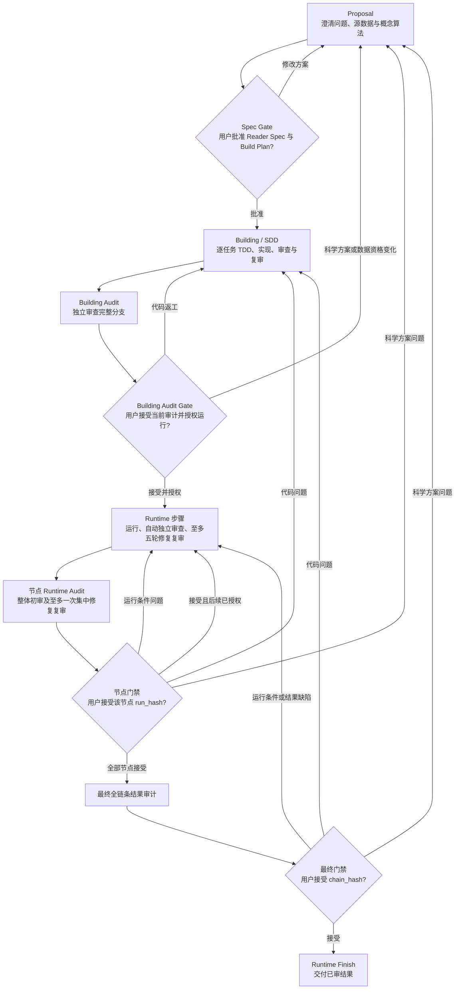

# Scientific Analysis Superpower

面向科研统计分析的 Agent Skill：以**一个最小功能单元**为范围，先确定科学方案与实施计划，再按 [Superpowers](https://github.com/obra/superpowers) 的 Subagent-Driven Development（SDD）方式逐任务开发、测试和审查，最后对正式运行及结果分别留痕和审计。

根目录的 [SKILL.md](SKILL.md) 是调度入口：它根据现有 Spec、Git 提交、审计报告和用户裁决判断当前阶段，按需读取对应模块。本 README 介绍流程；实际执行以 `SKILL.md`、`references/` 和 `templates/` 为准。

## 流程一览



| 阶段 | 主要工作 | 主要产物与停止点 |
|---|---|---|
| **Proposal** | 用 brainstorming 明确研究目标、合格源数据、概念算法和结论边界；用 writing-plans 拆出实施任务，并规划无环的 Runtime 步骤图及阶段性验收节点。 | `specs/reader_spec.md` 与 `specs/build_plan.md`。停在 **Spec Gate**，等待用户批准当前版本。 |
| **Building / SDD** | 在隔离的 Git 工作区按计划逐任务执行 TDD、实现、提交、独立 Task Review 和必要的修复复审。 | 代码、测试、临时技术账本及每任务一份人工验收报告；完成后进行完整分支审查。 |
| **Building Audit** | 一名独立 Reviewer 追溯 Spec、Plan、代码、测试及任务审查，形成正式报告。 | `audits/building/` 下的报告绑定当前提交，汇总并链接各任务人工报告；停在 **Building Audit Gate**。 |
| **Runtime** | 按获准的步骤图执行；每步自动独立审查，运行条件问题最多五轮修复复审。 | `results/`、日志及 `audits/runtime/report/` 中的逐步事实记录；通过的步骤才解锁下游。 |
| **Runtime Audit** | 每个验收节点独立整体审查并等用户接受；全部节点接受后另作最终全链条审计。 | `audits/runtime/` 的节点报告绑定各自 `run_hash`，最终报告绑定 `chain_hash`；两类正式报告均停在用户门禁。 |
| **Runtime Finish** | 整理已获接受的结果、复现信息、解释边界和限制。 | `reports/` 下的最终交付说明；不新增计算。 |

## SDD 怎样开发一个任务

Build Plan 决定任务边界。Building 不重新制定科学方案，而是按批准的计划执行：

1. 建立或核对隔离工作树，为本份计划创建 `.tmp/sdd/` 临时账本，并检查任务之间的依赖与接口冲突。
2. 从 Build Plan 提取 **Task N brief**，派独立实现 Agent。按 TDD 先用有独立依据的预期写失败测试，再做最小实现、重构、自查和 Git 提交。
3. 用任务开始时的 `BASE` 到当前 `HEAD` 生成完整 diff 包。独立 Task Reviewer 分别判断任务契约符合性与代码质量。
4. 有问题时由实现者修复并提交；Re-review 核对原发现和修复差异。最多五轮，仍有实质问题则停下交用户裁决。任务审查通过后，按批准的 AC 生成一份人工验收报告。
5. 所有任务完成后，先对**整个分支**做独立初审；可修复的实现缺陷最多集中修复一次并局部复审。更新受修复影响的人工报告后，生成带任务验收索引的正式 Building Audit；用户接受报告前不进入正式运行。

`pytest` 验证具体行为，语法／导入检查验证代码可加载，小规模真实样本 smoke test 验证入口和实际数据接口；它们都不能单独证明正式科研结果可信。任务审查关注局部实现，Building Audit 关注跨任务与科学方案的一致性，Runtime Audit 则关注**实际运行结果**。

### 审查范围为何分层

| 审查 | 主要阅读范围 | 要解决的问题 |
|---|---|---|
| Task Review | 当前 Task brief、实现报告、适用科学约束与从任务开始的 `BASE..HEAD` 完整 diff | 本任务是否满足批准的 AC，代码和测试是否可靠。若有具体跨模块风险，可定向读取未修改代码；无法从 diff 证实的内容须标明。 |
| 修复 Re-review | 原 finding、修复报告及本轮修复差异 | 原问题是否真正解决，修复是否引入新问题。 |
| 整体 Building Review | 整个开发分支的差异、Reader Spec、Build Plan、各任务报告及验证证据 | 跨任务接口、科学口径和完整实现链是否一致。它不逐行重审仓库里无关的旧代码。 |

Task Review 聚焦变更以控制注意力负担；整体审查补查跨任务关系。`diff` 没有发现问题不等于未修改依赖和正式运行都已验证。

## Runtime 如何分批运行和验收

Build Plan 分别列出 **Build Task** 和 **Runtime 步骤**。前者按可独立开发、测试和审查的代码工作划分；后者按正式运行的前置条件和产物排列。一个 Build Task 可以提供多个运行步骤，几个步骤也可以组成一个由用户验收的阶段性节点。步骤与节点的依赖图都不得有环；可并行的步骤不得写入同一可变产物。这个划分在 Proposal 阶段由用户审阅，不由 Agent 在运行时临时决定。

1. **步骤内自动审查。** 只执行本次获授权的步骤。每次尝试保存事实记录、输入与产物身份；独立 Reviewer 对照该步 AC 审查。运行条件问题可修复、重跑、复审，最多五轮；失败步骤的下游不得读取其产物。
2. **阶段性节点人工验收。** 节点内所有必需步骤通过后，先做跨任务初审；获准范围内最多一次集中修复与局部复审。正式节点 Runtime Audit 绑定该节点的 `run_hash`，生成后停下等用户接受。接受节点不自动扩大后续运行授权。
3. **最终全链条验收。** 所有节点获接受后，独立审计节点间的输入输出、版本关系、最终结果和解释边界。正式报告绑定由各节点审计身份组成的 `chain_hash`；用户接受后才进入 Runtime Finish。最后一个节点的局部审计不能替代这份整体审计。

返工先记录证据、批准依据、拟修改对象及受影响下游：获准的环境、传输或恢复问题留在 Runtime；修改已审代码返回 Building 并重过其审计门禁；改变源数据资格或科学方法返回 Proposal。根因不明或五轮后仍有实质问题时，停止受影响的依赖链。修复只使受影响产物及其下游审计失效，未受影响的上游结果可在核对身份后复用。

运行尝试和节点的事实记录保存在 `audits/runtime/report/`，自动步骤审查记录保存在 `audits/runtime/task-review/`，正式节点与最终审计保存在 `audits/runtime/`；`reports/` 只用于 Runtime Finish 后面向研究者的结果交付。

## 返工如何定位

| 核实后的原因 | 返回阶段 |
|---|---|
| 源数据资格、研究目标、概念算法、统计方法或结论边界需要改变 | **Proposal**：修订 Reader Spec 和受影响的 Build Plan，重新获得批准。 |
| 代码实现、接口、性能或恢复逻辑需要修改 | **Building**：补测试、修复并提交，重新进行受影响审查和 Building Audit。 |
| 环境、获准配置、缓存或可恢复运行故障，且方案与代码仍适用 | **Runtime**：修正运行条件后重跑，生成新的 `run_hash` 并重新审计。 |

结果不符合预期时，先记录事实并由 Runtime Audit 判断原因。审计报告中的“已确定”“待讨论”“本轮暂缓”与实施状态分开记录；用户决定不等于修复完成，旧审计也不能自动放行新提交或新运行。

Build Plan 的开发任务与 Runtime 步骤分别编号；步骤图及节点图均不得有环。运行节点可以汇集多个 Task 的成果，Task 也可以实现多个运行步骤。自动步骤审查不设置人工门禁；正式节点审计和最终全链条审计都须由用户接受。接受上游节点不自动扩大后续授权。返工按拟修改对象和实际改动核对路由，受影响的结果及下游审计失效，未受影响上游经身份核验后可复用。

## 如何使用

将本仓库作为 `scientific-analysis-superpower` Skill 使用。若同一台电脑有多个项目，可在每个项目的 `.agents/skills/scientific-analysis-superpower/SKILL.md` 放一个薄入口，指向同一份本地 Git 仓库的根 `SKILL.md`，并要求按该仓库目录解析相对链接；更新时只需在中央仓库拉取一次。薄入口仅保留一个可发现的 Skill，内部模块由调度器按需读取。直接调用 **`$scientific-analysis-superpower`**，提供一个功能单元的路径、目标和已知数据来源；不需要另设 workflow。Agent 应先定位当前阶段，读取该阶段所需材料，而不是一次加载所有文件。

首次调用示例：

> 使用 `$scientific-analysis-superpower` 为这个功能单元制定方案。数据位于……，目标是……；先核对源数据资格，生成 Reader Spec 和 Build Plan，停在 Spec Gate 等我审阅。

已有 Spec、审计或运行记录时，可直接给出功能单元路径并说明“继续”。调度器会检查**当前版本**的门禁状态；“继续”本身不替代批准。正式文档默认中文。

一个功能单元通常按需使用以下目录，不要求为尚未开始的阶段创建空文件：

```text
<功能单元>/
├─ specs/                 # Reader Spec、Build Plan（Markdown）
├─ scripts/
│  ├─ build/             # 实现脚本
│  ├─ config/            # 配置与指纹
│  ├─ pytest/            # 行为测试
│  ├─ smoke_test/        # 小样本冒烟测试
│  └─ logs/              # 运行日志与运行状态
├─ results/               # data/、plot/、smoke_test/
├─ audits/                # building/report/ 人工任务报告、runtime/report/ 运行事实记录及两阶段审计报告
├─ reports/               # Runtime Finish 后的结果交付说明（Markdown）
└─ .tmp/sdd/              # 每份 Build Plan 的临时账本、brief、review 与 diff 包
```

## 文件入口

- [SKILL.md](SKILL.md)：阶段路由、门禁及总规则。
- [Proposal 规则](references/spec-stage.md)、[Reader Spec 模板](templates/reader-spec.md)、[Build Plan 模板](templates/build-plan.md)：科学方案和可执行任务计划。
- [Building 边界](references/build-stage.md)、[SDD 模块](skills/subagent-driven-development/SKILL.md)、[TDD 模块](skills/test-driven-development/SKILL.md)、[人工任务报告模板](templates/task-human-report.md)：逐任务开发、审查与人工验收证据。
- [Building Audit 模板](templates/building-audit-report.md)：完整分支审计及用户逐项裁决。
- [Runtime 规则](references/runtime-stage.md)、[自动步骤审查提示词](templates/runtime-task-reviewer-prompt.md)、[Runtime Audit 规则](references/runtime-audit.md)、[Runtime Finish 规则](references/runtime-finish.md)：分批运行、逐步审查、节点与最终审计及交付。
- `docs/`：设计讨论和人工阅读材料，不是 Agent 的执行入口。

## 当前验证状态

流程和模板已建立；Building 与 Runtime 的步骤级审查在各自五轮上限内闭环，正式审计仍由用户裁决。SDD 临时材料何时清理，以及分批 Runtime 的实际端到端衔接仍需在真实功能单元中验证。

## 来源与许可

SDD、TDD、brainstorming、writing-plans 等模块基于 [obra/superpowers](https://github.com/obra/superpowers) 改造；本项目增加了科研 Spec、源数据资格、Building/Runtime 门禁和结果审计。仓库目前有两份许可文件：根目录的 [LICENSE](LICENSE) 是署名 `houhoudehenduohhh` 的 MIT 文本；[LICENSE-superpowers](LICENSE-superpowers) 保留原项目作者 Jesse Vincent 的 MIT 文本。这是对现有文件的描述，原创部分是否继续采用 MIT 应由权利人决定。
