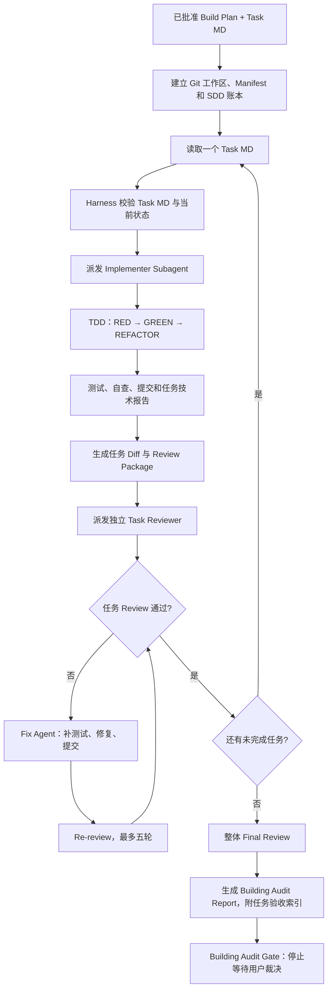

# Building 阶段框架

Building 负责把已批准的 Build Plan 和 Task MD 转化为可审查的代码、测试和提交。Building 不运行正式科研分析，不生成正式 Runtime 结果，也不能绕过 Building Audit 进入 Runtime。

## 一、流程图



## 二、Building 的输入

只有以下内容可以作为 Building 的工作依据：

- 已通过 Spec Gate 的 `build_plan.md`
- 已通过 Spec Gate 的本轮 Task MD
- 当前任务适用的输入、输出和验收条件
- 当前 Git 工作树和提交范围
- Build Plan 批准的功能单元 Git 根目录。上层目录由用户管理，当前单元在自己的独立工作树下存放 SDD 状态与审计证据。
- Harness 的当前状态、Building Manifest 和 SDD 账本

Proposal 未批准的文件、旧版本 Task MD、未绑定当前版本的审查报告不能作为当前任务的批准依据。

## 三、Task 级开发流程

### 1. 任务进入

- Harness 验证 Build Plan、Task MD 和当前状态。
- 记录任务完整 ID、Task MD 指纹和当前 `BASE` 提交。
- 建立任务 brief、工作目录和任务报告路径。

### 2. Implementer 开发

Implementer 只接收当前任务所需的 Task MD、接口和约束，不接收无关任务的完整上下文。

TDD 是 Implementer 的内部开发方式，用户不需要在每轮对话中阅读 TDD 细节。Implementer 必须按以下顺序留下证据：

```text
RED
  先写能够证明 AC 的失败测试，并确认测试确实失败
GREEN
  编写满足失败测试的最小实现，并确认测试通过
REFACTOR
  在不改变行为的前提下整理代码，再运行相关测试
```

任务报告至少记录：

- 实现了哪些 AC
- RED 测试、命令和失败证据
- GREEN 测试、命令和通过证据
- 重构内容
- 未覆盖的 AC 和限制
- 代码提交和测试文件

测试通过只证明对应行为得到验证，不能直接证明整个任务或科学结果完成。

### 3. Task Review

独立 Task Reviewer 审查：

- Task MD 的目的和边界是否满足
- 每条 AC 是否有对应实现和测试证据
- 输入、输出和任务接口是否符合计划
- 代码差异是否引入未批准行为
- 测试是否验证真实行为
- 失败处理和边界条件是否合理

Task Reviewer 不修改代码。审查结果写入 SDD 临时工作区，并保留任务报告、Diff 和 Review Package。

### 4. Fix Loop

Task Review 发现问题后：

```text
CHANGES_REQUIRED
  → Fix Agent
  → 增加或修订失败测试
  → 修复代码
  → 提交新版本
  → 只审查修复差异并进行 Re-review
```

每个任务最多五轮修复与复审。达到上限仍存在实质问题时，任务不能标记完成，依赖任务不能继续，必须交用户裁决。

## 四、Building 证据文件

### 正式依据

```text
specs/build_plan.md
specs/tasks/task-<NN>/task-<NN>.md
```

### SDD 临时证据

```text
.tmp/sdd/<plan-id>/
├── progress.md
├── task-<id>-brief.md
├── task-<id>-report.md
├── task-<id>-review.md
├── task-<id>-fix-r<round>.md
├── task-<id>-re-review-r<round>.md
├── review-package-<base>-<head>.md
└── final-review-*.md
```

这些文件生成后保持不可变，供 Agent 恢复、复查和生成最终审计证据。任务完成后仍需保留到 Building Audit 完成。

### Building 审计证据

```text
audits/building/
└── building-audit-<version>.md
```

正式 Building Audit 的「6. 任务验收索引」集中供人工验收。逐任务列出完整 ID 和任务目的，逐 AC 写明成功标准、当前判定、实际验证到的行为及未验证范围。返工只摘要描述解决了哪些 AC 及复审结果。独立 `task-<id>-human-report.md` 退出生成流程，门禁解除对该文件的依赖。

正式报告仍审查整个分支、任务证据、差异、测试及跨任务接口。Harness 核对验收索引是否覆盖全部获批任务和 AC，并独立核对任务技术报告、Task Review、Final Review、提交和规格指纹。详细测试与审查证据保存在 SDD 工作区。

## 五、Building 完成条件

只有以下条件全部满足，才可以生成正式 Building Audit：

```text
所有计划任务都有完整 Task ID
每个任务都有 Implementer 报告
每个任务都有 Task Review 或 Re-review 结果
所有任务的实质问题已解决，或已达到五轮并交用户裁决
每个任务的 TDD、pytest 和必要 smoke 证据已记录
正式报告任务验收索引覆盖全部获批任务与 AC
本轮实际主入口符合获批路径
Final Review 已完成
当前 Git 提交、Build Plan、Task MD 和审计证据已绑定
```

Building Audit 报告生成后必须停止。用户接受当前版本和限制，并明确授权 Runtime 后，才允许进入 Runtime。

## 六、返回路径

| 发现的问题 | 返回阶段 |
|---|---|
| 测试缺失、代码逻辑错误、接口错误、性能实现问题 | Building：补测试、修复、Task Review 和 Re-review |
| 源数据资格、研究目标、目标量、统计方法或概念算法变化 | Proposal：更新 Build Plan 和受影响 Task MD，重新批准 |
| 仅为测试环境、缓存、配置或可恢复运行条件问题 | Runtime：在获批范围内处理并重新运行 |

Building 不根据测试通过或代码可编译就宣布完成。只有当前 Building Audit 形成并通过用户门禁，才可以交接 Runtime。

## 七、冒烟结果与下一轮 pytest 验收

- 实现 Agent 将本轮主入口和实现模块写入 `scripts/build/`。Building 核对本轮实际 Git 变更和入口路径，合法入口通过，根目录出现本轮新增主脚本时阻断。既有未改动的入口不触发全仓迁移。
- 功能单元的冒烟输出放在 `results/smoke_test/`。确需给人单独看小样本报告时，与该次结果并置为 `results/smoke_test/<run_id>/smoke-report.md`。常规摘要直接写入 Building Audit 的任务验收索引，详细机器证据放在 `.tmp/sdd/<plan-id>/`。常规运行日志放在 `scripts/logs/`。
- 本次的 `sdd-workflow-smoke.md` 是对 Skill 全流程的专项验证复盘。它属于开发验证材料，不是 T01 功能单元冒烟报告，也不作为标准交付。
- pytest 验证没有独立人工任务报告时，完整技术证据和验收索引仍可完成交接。缺任务或 AC、缺独立审查、当前提交和证据不匹配时仍须阻断。保留同一获批 Git 工作树的检查。
