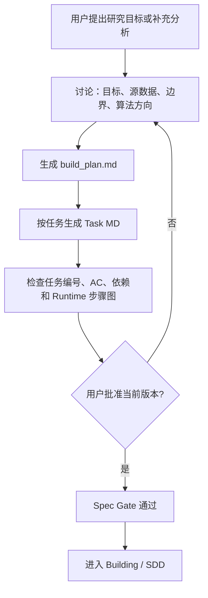

# Proposal 阶段框架

Proposal 只负责把用户的研究想法整理成可执行的 Build Plan 和任务说明书。它不生成代码、不运行正式分析、不进行 Building Audit，也不进入 Runtime。

## 一、流程图



## 二、Proposal 的正式输出

Proposal 只产生以下两类 Markdown 文件：

```text
<functional-unit>/specs/
├── build_plan.md
└── tasks/
    ├── task-01/
    │   └── task-01.md
    └── task-02/
        ├── task-02.md
        └── task-02-ext01.md
```

### `build_plan.md`

Build Plan 是整个功能单元的任务总览，至少包括：

- 功能单元目标和交付范围
- 「目标与边界」中的功能单元 Git 根目录，由用户随计划批准
- 源数据身份、版本、资格和使用边界
- 算法概括及主要计算逻辑
- 任务索引
- 每个任务的目的和边界
- 每个任务的验收条件索引
- 任务前置依赖与可并行关系
- 无回环的 Runtime 步骤图
- 阶段性验收节点。逐节点接受后另行进行最终全链条审计，单节点计划沿用同一流程。
- 项目目录结构、拟创建的主入口及其相对路径
- 拟交付的数据、图件和小样本结果，写明逻辑文件名和必要分组
- 当前版本、待讨论事项和批准状态

Build Plan 不展开每个任务的全部实现细节。具体任务内容写入对应的 Task MD。

新建或新增的分析主入口及实现模块放在 `scripts/build/`。配置、测试、冒烟入口和日志分别放在 `scripts/config/`、`scripts/pytest/`、`scripts/smoke_test/`、`scripts/logs/`。Build Plan 和 Task MD 应声明一致的脚本路径。新增或迁移的主入口使用 `scripts/build/` 下的路径。可登记并继续调用未修改的既有主入口。迁移时，计划需说明受影响的调用方。

计划为数据、图件和冒烟结果分别声明 `results/data/`、`results/plot/`、`results/smoke_test/` 下的逻辑路径。逻辑路径只包含读者需要的文件名和分组，运行编号由 Harness 登记，步骤和尝试轮次由执行证据记录。技术运行记录、步骤审查和调试材料不列为交付。

### Task MD

每个 Task MD 是一个独立任务的说明书，至少包括：

- 完整任务 ID
- 父任务 ID（扩展任务适用）
- 变更类型：原始、新增或替换
- 任务目的
- 任务边界和明确排除项
- 继承的科学、数据和工程约束
- 输入、输出及接口
- 具体验收条件（AC）
- 测试、冒烟测试或 Runtime 验证要求
- 上下游影响
- 是否需要重新审查下游任务
- 审批引用和文档版本

新增分析或补充研究应在父任务目录下新增完整 ID 的 Task MD，并更新 Build Plan 的任务索引。只有在研究目标、数据资格或上位算法边界发生变化时，才需要修改 Build Plan 的总体部分。

## 三、Proposal 的执行顺序

1. 确定一个最小功能单元及其工作目录。
2. 讨论研究目标、源数据、边界、算法方向和预期结果。
3. 生成或更新 `build_plan.md`。
4. 根据任务概要生成一个或多个 Task MD。
5. 检查任务之间的依赖、接口、AC 和 Runtime 步骤图。
6. 向用户呈现 Build Plan、Task MD、待决事项、版本编号和拟初始化 Git 的绝对路径。
7. 用户批准当前版本后，停止 Proposal，进入 Building。

Proposal 阶段允许多轮修改。用户未批准前，不能派发实现 Agent，不能写生产代码，不能生成 Building Audit，也不能启动 Runtime。

## 四、Proposal 所需文件

### 必需文件

```text
SKILL.md
references/proposal-stage.md
templates/build-plan.md
templates/task-spec.md
```

- `SKILL.md`：根调度器只负责判断当前是否处于 Proposal 及下一阶段路由。
- `references/proposal-stage.md`：Proposal 的最小执行规则和 Spec Gate。
- `templates/build-plan.md`：功能单元总计划模板。
- `templates/task-spec.md`：单个任务说明书模板。

### Harness Proposal 校验

```text
skills/subagent-driven-development/scripts/sdd-harness.py
```

Proposal 校验是 Harness 的必经步骤，只做确定性格式检查，不替代用户对科学方案的判断。每次生成或修改 `build_plan.md`、Task MD 后，必须先通过对应的 Harness 校验，再提交用户进行 Spec Gate 审阅。调用 `verify-build-plan` 和 `verify-task-spec`，至少检查：

- `build_plan.md` 是否使用固定章节，且不包含已删除的 Reader Spec、全局约束摘录和 Build 总体映射章节。
- Task MD 是否使用固定章节和 AC 表头。
- 任务 ID 是否唯一且符合命名规则。
- Task MD 是否都被 Build Plan 索引。
- 前置依赖是否存在。
- Runtime 步骤图是否有向无环。
- 每个任务是否具有目的、边界和至少一个 AC。

Proposal 不需要单独的脑暴脚本、计划生成脚本或通用代码审查脚本。讨论由主 Agent 完成，文件结构由模板约束，确定性结构由 Harness 校验。

## 五、Proposal 与 Building 的边界

Proposal 不调用 Building 的 SDD、TDD、审计或调试模块。讨论由主 Agent 完成，文件结构由模板约束，确定性结构由 Harness 校验。

## 六、Proposal 到 Building 的唯一交接条件

只有以下条件全部满足，才允许进入 Building：

```text
build_plan.md 已生成
所有本轮 Task MD 已生成并被索引
任务目的、边界和 AC 已明确
任务依赖和 Runtime 步骤图无回环
源数据和输出边界已记录
主脚本、结果类别和验收节点通过路径与结构检查
用户明确批准当前 Build Plan 与 Task MD 版本
```

进入 Building 后，任何科学目标、源数据资格或概念算法的实质变化，都返回 Proposal 重新讨论并重新批准。

## 七、下一轮 pytest 验收

- 通过结构化路径字段核对主入口。新计划指定功能单元根目录的脚本时在进入 Building 前拒绝，位于 `scripts/build/` 的合法入口通过。Build Plan 与 Task MD 的入口不一致时拒绝。
- 验证三类结果逻辑路径、必要分组、规范化后重名及路径越界。验证单节点与多节点计划都可完成 Proposal，并保留节点与最终审计两类交接。
