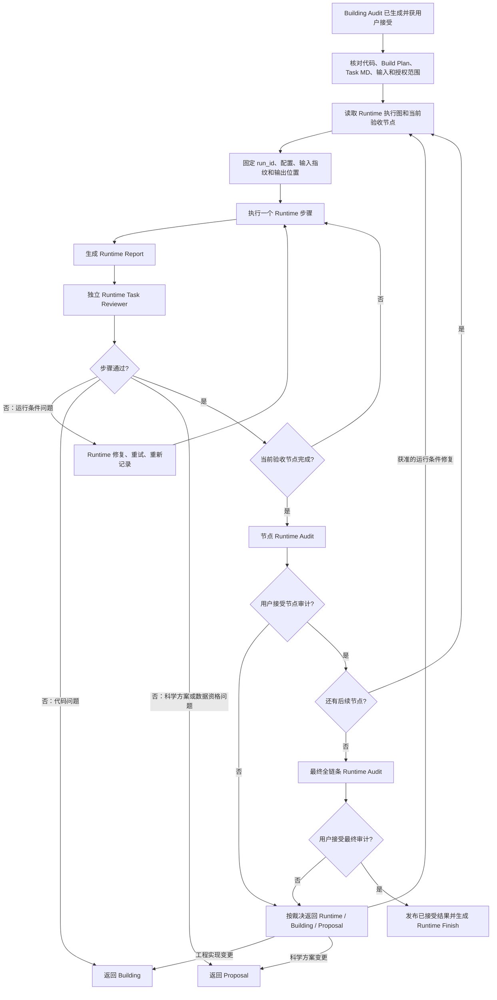

# Runtime 阶段框架

Runtime 负责运行已经通过 Building Audit Gate、并获得用户授权的代码和任务。Runtime 记录实际运行事实、阶段性结果和审计证据，不在运行过程中静默改变代码、科学算法、源数据资格或输出口径。

## 一、流程图



## 二、Runtime 的入口条件

只有以下条件全部满足，才允许启动 Runtime：

```text
Build Plan 和本轮 Task MD 已批准
Building Audit 已生成
Building Audit 已被用户接受
用户在看到当前 Building Audit 后明确授权运行
运行代码提交与 Building Audit 的 HEAD 一致
实际输入与批准的数据身份、版本和资格一致
运行配置、输出路径和资源范围在授权范围内
Runtime 执行图和当前节点已确定
前置节点的 Runtime Audit 已被接受
```

Runtime 不能从以下情况推断出运行授权：

- 用户只批准了 Proposal
- 用户说“继续”但没有接受当前 Building Audit
- 旧版本 Building Audit 已通过
- 代码已经能够编译
- pytest 已通过
- 之前的 Runtime 节点已被接受

## 三、Runtime 的运行单位

Runtime 按 Build Plan 中的 Runtime 执行图运行，不直接把 Build Task 编号当作运行顺序。

每个 Runtime 步骤必须具有：

- 唯一 `step_id`
- 对应的 Build Task 和 AC
- 前置步骤或已接受节点
- 输入、输出和写入位置
- 运行配置和资源范围
- 可并行条件和互斥条件
- 完成检查

步骤之间必须形成有向无环图。失败重试是同一步的新尝试，不形成依赖回环。

## 四、Runtime 运行记录

每次运行前固定：

- `run_id`
- `step_id`
- `attempt`
- 代码提交
- Build Plan 和 Task MD 指纹
- Building `audit_id`
- 实际输入及其指纹
- 配置及其指纹
- 完整运行命令
- 环境和资源
- 输出位置

每次尝试结束后记录：

- 开始和结束时间
- 退出码
- 失败、重试和中断情况
- 实际资源使用
- 输出是否完整
- 输出文件及其指纹
- 异常和未验证范围

运行事实写入：

```text
.tmp/sdd/<plan-id>/runtime/<run_id>/
├── attempts/<step_id>/<attempt>/   # 尝试、待审产物与指纹
├── reports/                      # 步骤事实与节点事实汇总
├── reviews/                      # 独立步骤审查及正式审计前的技术审查
└── evidence/                     # 授权、范围、验收与发布记录
```

Runtime Report 由 Harness 在每次尝试结束或节点汇总时生成，记录输入、命令、退出情况和产物指纹。Runtime Task Review 由独立 Reviewer 生成，逐项核对证据能否支撑 AC。这些都是供 Agent 审计、恢复与重跑的中间证据。常规运行日志保存在 `scripts/logs/runtime/`。

`audits/runtime/` 根目录只存正式验收 Markdown。正式审计的「6. 任务验收索引」用人可读的文字说明任务、步骤、节点、阶段结果、AC 判定、未覆盖范围与状态，移除「事实记录与审查链接」列。机器证据路径和指纹由 Harness 从 Manifest 和绑定记录读取。

文件名用于定位节点、步骤、运行及轮次。报告正文和 Manifest 保留 `step_run_hash`、`run_hash`、`chain_hash` 及证据指纹，由 Harness 核对实际文件内容。使用独立运行编号和审计序号留存多次记录。

## 五、Runtime Task Review

每个运行步骤完成后，由未执行该步骤的独立 Reviewer 审查：

- 实际输入是否与批准输入一致
- 代码、配置和命令是否属于 Building Audit 授权范围
- 输出是否完整、可读取且符合 schema
- 数量、单位、分母、缺失和数值边界是否合理
- 失败和重试是否被完整记录
- 当前步骤是否满足对应 AC
- 下游步骤是否可以读取当前输出

Runtime Task Review 只负责步骤级事实核对，不替代节点 Runtime Audit，也不进行用户验收。

## 六、Runtime 步骤返工

同一个步骤最多五轮运行条件修复和复审。

### 留在 Runtime

- 获准范围内的配置错误
- 缓存、传输或环境问题
- 可恢复的调度失败
- 不改变代码和科学口径的参数修正
- 输出目录或运行状态恢复

### 返回 Building

- 算法转代码错误
- 代码逻辑错误
- 接口或数据结构错误
- 性能和资源管理需要修改代码
- 依赖、调度或恢复逻辑需要改代码

返回 Building 后必须：

```text
增加或修订失败测试
修复代码
完成 Task Review 和 Re-review
重新执行 Building Audit
重新获得用户授权
重新运行受影响步骤
```

### 返回 Proposal

- 源数据资格变化
- 目标量变化
- 统计方法变化
- 概念算法变化
- 关键假设变化
- 结论边界变化

返回 Proposal 后必须更新 Build Plan 和受影响 Task MD，并重新通过 Spec Gate。

## 七、阶段性验收节点

Runtime 节点使用 Build Plan 中的 `N01`、`N02` 等编号。

一个节点包含一个或多个已完成的 Runtime 步骤，形成用户可以审查的阶段性成果。节点完成后必须完成该节点的正式 Runtime Audit：

```text
Runtime 步骤完成
  → Runtime Report 完成
  → Runtime Task Review 通过
  → 节点审计
  → 用户接受当前范围
  → 归档并进入下一节点 Proposal，或进入最终全链条审计
```

下游节点根据获批计划依赖已验收的上游记录。下一节点仍需完成自身 Spec、Building Audit 和运行授权。旧分批计划沿用同批既有运行门禁。

## 八、节点 Runtime Audit

节点审计必须核对：

- 节点内所有步骤和尝试
- 每个步骤的 AC 状态
- 输入、配置、代码和输出身份
- 前置节点和跨任务接口
- `step_run_hash` 和节点 `run_hash`
- 失败、重试、旧缓存和混合版本
- 结果 schema、数量、单位、分母、缺失和数值边界
- 结果是否超出 Build Plan 和 Task MD 的结论边界

正式报告写入：

```text
audits/runtime/
└── runtime_audit_<node 或 final_chain>_<sequence>_<date>.md
```

节点 Runtime Audit 生成后必须停止，等待用户接受当前报告。Harness 用审计编号和范围指纹绑定裁决。

## 九、最终全链条 Runtime Audit

所有计划节点都获接受后，另行进行一次最终全链条审计。即使计划只有一个节点，也保留节点验收和最终验收各自的独立报告与裁决。

最终审计核对：

- 已接受的节点审计
- 所有节点的 `run_hash`
- 依赖顺序和跨节点接口
- 最终 `chain_hash`
- 最终结果和结果清单
- 运行版本、输入版本和配置版本
- 科学解释是否超出 Build Plan 和 Task MD 的边界

最终报告生成后停在最终 Runtime Audit Gate，等待用户接受对应审计身份、范围指纹和报告限制。

## 十、结果发布与 Runtime Finish

对应范围的正式审计获接受后，将约定交付发布到结果目录。同一运行内使用有意义且不冲突的逻辑名称，已发布的运行版本按 `run_id` 留存。

```text
results/
├── data/<run_id>/<文件或必要分组>
├── plot/<run_id>/<文件或必要分组>
└── smoke_test/<run_id>/<小样本结果及按需的 smoke-report.md>
```

每个类别只统一增加一层运行编号。步骤和尝试轮次留在 `.tmp`。发布时核对被审指纹并登记公开的结果路径与来源尝试，防止覆盖旧运行。失败或废弃尝试留在工作区。同节点依赖可使用已获步骤审查的暂存产物，跨节点复用仍须前置节点通过用户门禁。发布后 Harness 仍须能核对所审内容及交付路径，无须为了留证长期维护两份相同的大结果。

最终全链条审计获接受后，在 `reports/` 生成一份简短结果说明。正文只有两个主题：

1. **阶段性结果**，说明完成了什么、得到什么，必要时直接链接最终结果。
2. **结果局限**，说明结论能支持到哪里、哪些问题本轮无法解决或不在范围内。

完整结果清单、哈希和运行追溯由 Harness 在 Manifest 中校验和留存。人工说明无需逐文件校验表、运行命令或技术链接。Runtime Finish 不追加运行，也不改动已审结果。

## 十一、Runtime 的不可违反规则

```text
没有 Building Audit Gate，不运行正式分析
没有 Runtime Report，不进行 Runtime Audit
没有 Runtime Task Review，不解锁依赖步骤
没有节点 Runtime Audit，不解锁依赖节点
没有用户接受节点审计，不启动后续节点
没有已接受的最终全链条审计，不进入 Runtime Finish
代码变化返回 Building
科学方案或数据资格变化返回 Proposal
运行条件变化留在 Runtime
```

## 十二、下一轮 pytest 与端到端验收

- 验证单节点和多节点均有独立节点与最终审计。缺裁决、错误指纹、缺独立审查或负面审计时不能交付。多节点保留各自接受门禁与后续运行授权，覆盖计划多节点但本次只运行一个的情况。
- 验证两类事实报告和步骤审查位于当前功能单元的 `.tmp`。新的 `audits/runtime/` 只新增正式审计。原运行的证据按照原路径留存，可继续查询。
- 验证数据、图件、冒烟的目标目录及一层运行编号。失败和重试不污染结果区。发布时检测重名、越界、覆盖旧版本和指纹异常，证据仍可追溯。
- 验证精简 Runtime Audit 和两节 Finish 能完成全过程，缺授权和验收时仍须停止。按上述三个阶段框架先做 pytest 再由独立 Implementer、Reviewer 及必要的 Re-review 验证，最后从 Proposal 至 Runtime Finish 复跑。
