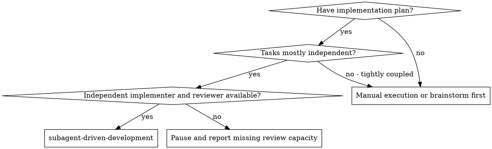
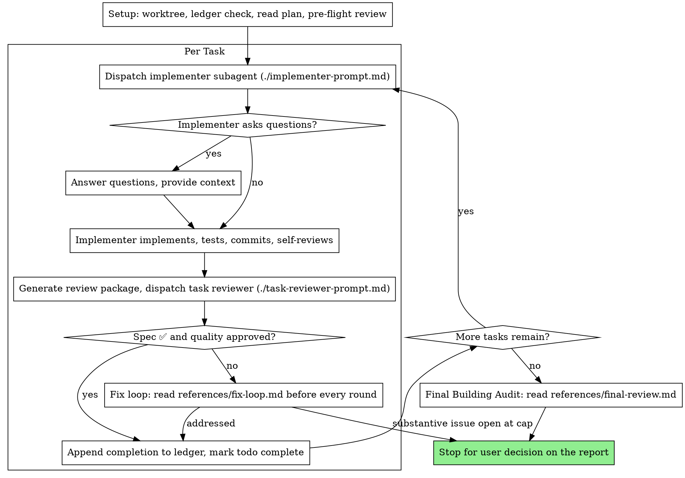

# Subagent-Driven Development

The root router must keep the workflow in SDD until its Building gate passes.
Run `scripts/check-building-gate` before reporting Building complete. If the
repository lacks Git, run `scripts/ensure-git` first and record its baseline.

Run `scripts/check-fix-loop` after every Task Review that reports
`CHANGES_REQUIRED` or Critical/Important findings. Until it passes, keep the
current task active and do not report completion or dispatch the next task.

Initialize and update the plan state with `scripts/sdd-harness.py`. Do not
advance a task or phase by prose alone. A rejected transition is a hard stop.

Execute plan by dispatching a fresh implementer subagent per task, a task review (spec compliance + code quality) after each, and a broad whole-branch review at the end. For scientific analysis, read [Building boundaries](../../references/build-stage.md) first; the final review produces a Building Audit report and stops for user decision.

**Why subagents:** You delegate tasks to specialized agents with isolated context. By precisely crafting their instructions and context, you ensure they stay focused and succeed at their task. They should never inherit your session's context or history — you construct exactly what they need. This also preserves your own context for coordination work.

**Core principle:** Fresh subagent per task + task review (spec + quality) + broad final review = high quality, fast iteration

**Narration:** between tool calls, narrate at most one short line — the
ledger and the tool results carry the record.

**Continuous execution:** Do not pause to check in with your human partner between tasks. Execute approved tasks without routine check-ins. Stop for a material scientific or Build Plan change, an unresolved substantive defect at the five-round cap, the conditions below, or completion of the final Building Audit report.

**Rulings, not stalls.** A running plan does not wait on a human. Conflicts,
ambiguities, plan defects, a cap you would have asked to exceed — decide
them. The spec is the binding authority, the plan is its argument, and your
judgment settles what neither answers. Record every decision in the ledger as
`Ruling: <what you decided> — <why> — <what it costs if wrong>`, and keep
going. A wrong ruling costs rework your human partner can see and undo; a
session parked on a question costs their whole day and buys nothing.
For scientific analysis, this applies only to choices within the approved
Spec and Plan. Material changes and unresolved substantive findings at the
five-round cap go to the user.

Four general conditions stop you: an irreversible or destructive
operation; a security-sensitive action; a side effect outside this worktree
that norms say you ask about first (a merge, a push to a shared branch, a
publish); and a plan so broken that every path forward is a guess. For those,
stop and ask. The scientific-analysis stops above apply as well.

## When to Use

## The Process

## Setup

Ensure the work happens in an isolated workspace: use
[using-git-worktrees](../using-git-worktrees/SKILL.md) to create one or verify the existing one.
Never start implementation on a main/master branch without your human
partner's explicit consent.

Conversation memory does not survive compaction. In real sessions,
controllers that lost their place have re-dispatched entire completed task
sequences — the single most expensive failure observed. Track progress in
a ledger file, not only in todos.

- Each plan owns a workspace: at skill start, run this skill's
  `bash scripts/sdd-workspace PLAN_FILE` by its absolute path, from the
  working tree you're executing in — it prints the plan's git-ignored
  directory (under the functional unit's `.tmp/sdd/` when its plan is in
  that working tree), home to
  every artifact for THIS plan: ledger, briefs, reports, review packages.
  Another plan's directory is never yours to read or write.
- Check for this plan's ledger at `<workspace>/progress.md`. If one exists,
  read [references/resuming.md](references/resuming.md) before anything
  else: it says whose ledger it is and where to resume.
- Create the ledger with its identity as the first line:
  `# SDD ledger — plan: <plan file path>`.
- The ledger is your recovery map: the commits it names exist in git even
  when your context no longer remembers creating them. After compaction,
  trust the ledger and `git log` over your own recollection.
- `git clean -fdx` will destroy the workspace (it's git-ignored scratch); if
  that happens, recover from `git log`.

Read the plan once, note its context and Global Constraints, and create a
todo per task. If the plan names a Spec, read that too: the spec is the
authority the plan argues from, and conflicts inside the plan resolve
against it. A plan with no reachable spec gets a ledger note saying so —
rulings made without one are provisional.

Before dispatching the first task of each approved plan revision, read [references/preflight.md](references/preflight.md)
and run the conflict scan it describes. Its table and rulings go in the
ledger.
For scientific analysis, rulings cannot change an approved scientific
decision or materially rewrite the Build Plan without user approval.

## The Task Loop

**Small same-shape work:** when the plan lists several small edits of the
same kind across files, read [references/batching.md](references/batching.md)
before dispatching them.

Everything you paste into a dispatch prompt — and everything a subagent
prints back — stays resident in your context for the rest of the session
and is re-read on every later turn. Hand artifacts over as files.

**Waiting on dispatched subagents:** never poll a wait interface with
short timeouts, and never sit in one silent, open-ended wait either.
While you have local work — ledger updates, packaging the next review,
reading reports — keep working; child results arrive on their own.
When you are genuinely idle, wait in bounded stretches (five to ten
minutes, where your platform allows), and between stretches post one
line of status and reconcile your live children: list them, and chase
any that finished without reporting. A bounded stretch keeps nearly
all of a long wait's efficiency while guaranteeing a stuck or lost
child is noticed within minutes, not at the end of the session.

### 1. Dispatch the implementer

Record BASE (`git rev-parse HEAD`) before dispatching — the review package
and fix-round diffs need it.

- **Task brief:** before dispatching an implementer, run this skill's
  `bash scripts/task-brief PLAN_FILE TASK_ID` by its absolute path, from the
  working tree you're executing in — it extracts the task's full text to a
  uniquely named file and prints the path. For indexed plans, match the complete ID and verify the source and extracted snapshot bytes against the approved Task MD fingerprint before dispatch. Keep the verified snapshot for the implementer, reviewer and re-review. Use the full ID in the ledger, artifacts and review dispatch. Compose the dispatch so the
  brief stays the single source of
  requirements. Your dispatch should contain: (1) one line on where this
  task fits in the project; (2) the brief path, introduced as "read this
  first — it is your requirements, with the exact values to use verbatim";
  (3) interfaces and decisions from earlier tasks that the brief cannot
  know; (4) your resolution of any ambiguity you noticed in the brief;
  (5) the report-file path and report contract. Exact values (numbers,
  magic strings, signatures, test cases) appear only in the brief. Never
  make a subagent read the whole plan file. For scientific analysis,
  include only the Reader Spec requirements that bind this task.
- **Report file:** name the implementer's report file after the brief
  (brief `…/task-N-brief.md` → report `…/task-N-report.md`) and put it in
  the dispatch prompt. The implementer writes the full report there and
  returns only status, commits, a one-line test summary, and concerns.
- A dispatch prompt describes one task, not the session's history. Do not
  paste accumulated prior-task summaries ("state after Tasks 1-3") into
  later dispatches — a real session's dispatch hit 42k chars of which 99%
  was pasted history. A fresh subagent needs its task, the interfaces it
  touches, and the global constraints. Nothing else.
- The dispatch carries the no-subagents contract (it is in the
  implementer template): the implementer never dispatches subagents —
  not helpers, and never a reviewer. Review arrives from you, after the
  report. In real sessions, every reviewer a worker spawned duplicated
  the task review the controller dispatched anyway — a full extra
  review seat per task.
- If an earlier task parked a finding in the area this task touches, carry
  a pointer to that ledger entry in the dispatch.
- Record the implementer's agent identity from the dispatch result —
  fix-loop rounds 1-3 resume this agent.
- Never dispatch multiple implementation subagents in parallel (conflicts).

Template: [implementer-prompt.md](implementer-prompt.md)

### 2. Handle the report

Implementer subagents report one of four statuses. Handle each appropriately:

**DONE:** Generate the review package (`bash scripts/review-package PLAN_FILE BASE HEAD` by its absolute path, from the working tree you're executing in — it prints the unique file path it wrote; BASE is the commit you recorded before dispatching the implementer — never `HEAD~1`, which silently drops all but the last commit of a multi-commit task), then dispatch the task reviewer with the printed path.

**Any other status** (DONE_WITH_CONCERNS, NEEDS_CONTEXT, BLOCKED): read
[references/handling-reports.md](references/handling-reports.md) and follow
it, every time you get one.

If the implementer asks questions — before starting or mid-task — answer
clearly and completely, provide additional context if needed, and don't
rush it into implementation.

### 3. Review the task

Per-task reviews are task-scoped gates. The broad review happens once, at the
final whole-branch review. Never skip the task review, and never accept a
report missing either verdict — spec compliance AND task quality are both
required. Implementer self-review never replaces the task review; both are
needed.

- Hand the reviewer its diff as a file: run this skill's
  `bash scripts/review-package PLAN_FILE BASE HEAD` by its absolute path, from
  the working tree you're executing in, and pass the reviewer the file path
  it prints (or, without bash: `git log --oneline`, `git diff --stat`,
  and `git diff -U10` for the range, redirected to one uniquely named
  file). The output never enters your own context, and the reviewer sees
  the commit list, stat summary, and full diff with context in one Read
  call. Use the BASE you recorded before dispatching the implementer —
  never `HEAD~1`, which silently truncates multi-commit tasks. Never
  dispatch a task reviewer without a diff file.
- **Reviewer inputs:** the task reviewer gets three paths — the same brief
  file, the report file, and the review package — plus the global
  constraints that bind the task. For scientific analysis, provide only
  the applicable Reader Spec excerpt and task interface dependencies.
  Provide a unique task-review output path in the same plan workspace;
  the reviewer writes its full report there for recovery and final audit.
- The global-constraints block you hand the reviewer is its attention
  lens. Copy the binding requirements verbatim from the plan's Global
  Constraints section or the spec: exact values, exact formats, and the
  stated relationships between components ("same layout as X", "matches
  Y"). The reviewer's template already carries the process rules (YAGNI,
  test hygiene, review method) — the constraints block is for what THIS
  project's spec demands.
- Do not add open-ended directives like "check all uses" or "run race tests
  if useful" without a concrete, task-specific reason
- Do not ask a reviewer to re-run tests the implementer already ran on the
  same code — the implementer's report carries the test evidence
- Do not pre-judge findings for the reviewer — never instruct a reviewer to
  ignore or not flag a specific issue. If you believe a finding would be a
  false positive, let the reviewer raise it and adjudicate it in the review
  loop. If the prompt you are writing contains "do not flag," "don't treat X
  as a defect," "at most Minor," or "the plan chose" — stop: you are
  pre-judging, usually to spare yourself a review loop.
If the reviewer reports "⚠️ Cannot verify from diff" items, read
[references/cannot-verify.md](references/cannot-verify.md) before you mark
the task complete.

Template: [task-reviewer-prompt.md](task-reviewer-prompt.md)

### 4. The fix loop

The loop triggers when the review reports spec ❌, any Critical or Important
finding, or a ⚠️ item you confirmed as a real gap.

When it triggers, read [references/fix-loop.md](references/fix-loop.md) and
follow it. Read it again before every round, even if you read it earlier in
this session: it holds the round cap, the breaker, and the ledger line each
round writes, and your memory of it does not survive compaction.

### 5. Complete the task

When the review comes back clean, append the completion line to the ledger in the same
message as your other bookkeeping:

- `Task <full ID>: complete (commits <base7>..<head7>, review clean)`

For indexed plans, append the approved Task MD fingerprint to this line and record it in the ledger before the first dispatch so mid-loop resumption can verify it.

For scientific analysis, after the independent task review/re-review, use
[the human task report template](../../templates/task-human-report.md) to
write one Chinese-content Markdown report per task under the functional unit's
`audits/building/report/`, named `task-<N>-human-report.md`. Keep the implementer's technical `task-N-report.md` and
review records in the SDD workspace. The human report must trace every
approved AC to evidence or an explicit unverified status and map each repair
to its affected AC; it does not create a per-task human approval gate. Link
it in the ledger so the final reviewer can find it.

Then mark the todo complete and move on. For scientific analysis, a real
Critical/Important issue still open at the five-round cap pauses the
dependent task sequence for user decision; it is not marked complete by
parking it. Non-blocking findings stay visible in the ledger and final report.

## Final Review

When every task is complete, read
[references/final-review.md](references/final-review.md) and follow it. It
covers the whole-branch review, its single fix wave, and how you finish.

## Common Rationalizations

| Excuse | Reality |
|--------|---------|
| "Close enough on spec compliance" | Reviewer found spec gaps = not done. Fix or hit the cap and present unresolved substantive findings for user decision. |
| "I'll fix it myself, dispatching is overhead" | Controller fixes pollute your context and skip review. Resume the implementer. |
| "One more round will converge" | Past the cap, rounds don't converge — the failure is structural. Adjudicate and route. |
| "The reviewer will just find something new anyway" | Scoped re-reviews verify fixes; they cannot wander. New findings on untouched code go to the ledger, not the loop. |
| "This finding is obviously wrong, I'll drop it" | You adjudicate only at the cap, and every ruling is a ledger entry. Silent discards are forbidden. |
| "The fix was small, skip the re-review" | Unreviewed fixes are how regressions land. Every round ends with a scoped re-review. |
| "Reviews slow the loop down" | The loop without reviews is just unverified churn. Reviews are the loop's brakes and steering. |
| "Ledger bookkeeping is overhead" | The ledger is what survives compaction. Controllers without one have re-dispatched entire completed task sequences. |
| "The implementer spawned its own reviewer — free extra assurance" | It's a duplicate seat reviewing the same diff; the task review is the gate. A worker-spawned reviewer is a defect to flag, not rigor. |
